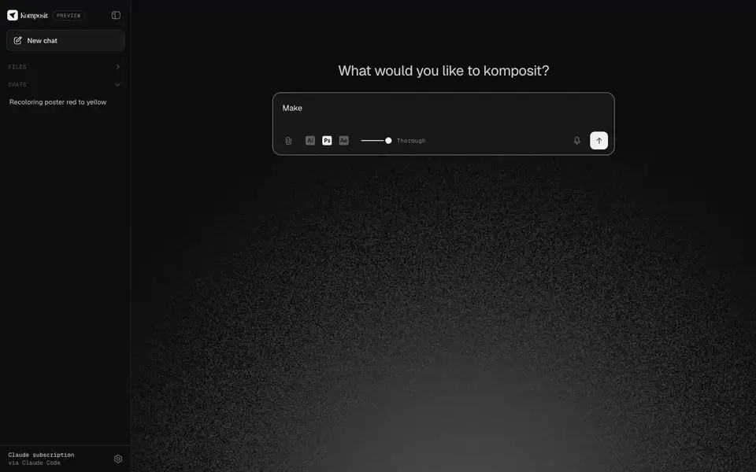

<p align="center">
  <picture>
    <source media="(prefers-color-scheme: dark)" srcset="brand/komposit-lockup-light.svg">
    
  </picture>
</p>

<p align="center"><b>A design agent harness for creative software.</b></p>

<p align="center">
  <a href="https://github.com/werqaferaw/komposit/releases/latest/download/Komposit-mac.dmg">Download for Mac</a> ·
  <a href="https://github.com/werqaferaw/komposit/releases/latest/download/Komposit-Setup-win.exe">Download for Windows (early build)</a> ·
  <a href="docs/getting-started.md">Getting started</a> ·
  <a href="https://komposit.werq.dev">Website</a>
</p>

---

Komposit lets an AI work directly in your open **Illustrator**, **Photoshop** and
**After Effects** documents. You say what you want in plain words. It reads the
live document and your selection, writes and runs its own ExtendScript, renders
the result so it can see its work, checks it, and tells you what it did.

<p align="center">
  
</p>

<table>
  <tr>
    <td width="33%"></td>
    <td width="33%"></td>
    <td width="33%"></td>
  </tr>
  <tr>
    <td valign="top"><b>Photoshop.</b> “Turn everything that's red into yellow.” It rendered its first pass, saw two lines had come out duller, and fixed them before it answered.</td>
    <td valign="top"><b>After Effects.</b> “Make NORTH, LONDON and FOREVER punch in as they land.” It set the keyframes and rendered this preview.</td>
    <td valign="top"><b>Illustrator.</b> “Rebuild this poster's title as vectors.” Built from the poster, attached as a reference.</td>
  </tr>
</table>
<p align="center"><sub>Real sessions on one poster, recorded in the app. Replay them step by step on <a href="https://komposit.werq.dev">the website</a>.</sub></p>

- **Live, not generated.** It edits your real file: layers, artboards, type,
  keyframes. Every change is in the app's undo history, and it saves only when
  you ask.
- **It looks before it answers.** After an edit it renders the document and
  checks the result against what you asked for.
- **Your AI, your keys.** Use your Claude plan through Claude Code, your ChatGPT
  plan through Codex, an Anthropic or Google Gemini API key, or any
  OpenAI-compatible provider (OpenRouter, OpenAI, a local model). Keys stay with
  you: on your computer, or in your browser when you use the web page.
- **Point by selecting.** Select something in the app and say "make this
  bigger" or "match these".
- **Exports.** PNG, print-ready PDF (Illustrator) and MP4 (After Effects), written
  as new files in a `Komposit Exports` folder, never over your work.

> **Status: preview.** The Mac app is the main build. Windows is an early build:
> it passes automated tests on Windows, but has had little time with real Adobe
> apps there. See [docs/windows.md](docs/windows.md).

## Install

| | Download | Needs |
|---|---|---|
| **Mac** | [Komposit-mac.dmg](https://github.com/werqaferaw/komposit/releases/latest/download/Komposit-mac.dmg) | macOS 13.5+, Apple silicon or Intel |
| **Windows** (early) | [Komposit-Setup-win.exe](https://github.com/werqaferaw/komposit/releases/latest/download/Komposit-Setup-win.exe) | Windows 10 or 11, 64-bit |

Both need Illustrator, Photoshop or After Effects, and an AI: a Claude Pro or Max
plan with [Claude Code](https://claude.com/claude-code), a ChatGPT Plus or Pro plan
with Codex, an Anthropic API key, a
Google Gemini API key, or an OpenAI-compatible key. The builds aren't signed yet, so macOS and Windows ask
you to confirm the first launch; [Getting started](docs/getting-started.md)
walks through it in about five minutes.

## How it works

```
 you ──▶ Komposit UI ──▶ local server (127.0.0.1) ──▶ AI (Claude Code / API)
                               │          ▲                    │
                               │          └── tool calls ◀─────┘
                               ▼
              Illustrator · Photoshop · After Effects
          (ExtendScript via AppleScript on a Mac, COM / AfterFX.exe on Windows)
```

A small local server (`companion/`) runs on your computer. It serves the UI,
talks to your AI, and gives the model a handful of tools: `inspect`, `edit`,
`render`, `export`, `save`, `preflight` and `undo`. The server only accepts
requests from Komposit's own UI (host, origin, token and JSON checks; see
[SECURITY.md](SECURITY.md)).

The same UI also runs as a web page at [app.komposit.werq.dev](https://app.komposit.werq.dev),
connected to the app on your computer. There, with an API key kept in your
browser, the page runs the agent itself and calls your AI directly, and the app
only runs the tools. The web page asks you to sign in with Google
([what that keeps](docs/privacy.md)); the app's own page needs no account.

| Directory | What's there |
|---|---|
| `companion/` | The local server: routes, settings, chats, the agent loop (`harness/`), AI engines (`engines/`, `providers/`), per-app bridges (`bridges/`), and everything OS-specific in `platform/` |
| `ui/` | The UI, plain HTML/CSS/JS, served locally or by `web/` |
| `packaging/` | The Mac menu-bar app and DMG; the Windows tray app, helper and installer |
| `web/` | Optional: a Cloudflare Worker that hosts the UI |
| `gateway/` | Optional: a Cloudflare Worker that lets invited people use the owner's Anthropic key, with limits |

[docs/architecture.md](docs/architecture.md) is the full map.

## Run from source

Needs Node 22 or later.

```bash
git clone https://github.com/werqaferaw/komposit.git
cd komposit
npm install
npm run serve        # http://127.0.0.1:4321
```

Choose an AI in the page's settings, open a document in an Adobe app, and ask.

```bash
npm test             # unit tests: no network, no Adobe apps
npm run check        # every module parses
npm run test:live    # drives the open Adobe apps (makes and closes its own documents)
npm run usage        # what your requests would cost at API prices (Claude subscription engine)
```

Building the apps: `npm run build:mac` on a Mac (needs the Xcode command-line
tools); the Windows installer is built by the `windows` GitHub Actions workflow.
See [docs/releasing.md](docs/releasing.md).

## Use the tools from Claude Code directly

Komposit's tools are also an MCP server, so you can drive a document from a
Claude Code session without the Komposit UI:

```bash
claude mcp add komposit -- node "$PWD/companion/mcp/doc-server.mjs" --app illustrator
```

Then ask Claude Code something like "use komposit to inspect my Illustrator
document". Use `--app photoshop` or `--app aftereffects` for the other apps.

## Contributing

Issues and pull requests are welcome; see [CONTRIBUTING.md](CONTRIBUTING.md).
Please report security problems privately ([SECURITY.md](SECURITY.md)).

## License

[MIT](LICENSE). The Komposit name and logo are not covered by the license.
